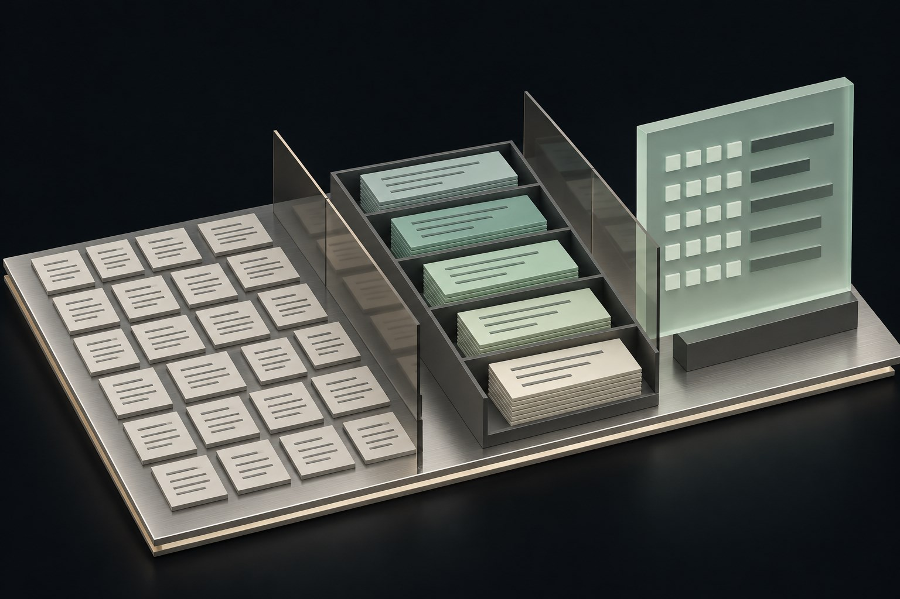
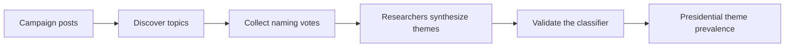

<p align="center"></p>
<h1 align="center">TopicLLM</h1>
<p align="center"><strong>From language to evidence. Built for review.</strong><br>A human-guided research method. An executable protocol for your agent.</p>
<p align="center"><a href="https://topicllm.dev/app/">Explore the Trump walkthrough</a> · <a href="https://topicllm.dev/paper/">Read the methods</a> · <a href="https://topicllm.dev/audit/">Research in action</a></p>



**What is a large collection of text about—and how does that change?** TopicLLM connects topic discovery, repeated LLM naming, human interpretation, classifier validation and prevalence estimation. It gives researchers a method to inspect and coding agents a concrete implementation to execute.

Born in dissertation research at **The University of Texas at Austin**, this release has two clear entry points:

- **Research in action:** the unchanged dissertation and two study papers document applications to alcohol marketing and information dynamics during COVID-19. They are historical research examples, available for review. Dissertation datasets are not distributed.
- **Learn by doing:** discover topics in **7,805 campaign posts**, develop human-defined themes, validate their measurement, and estimate their overall prevalence in **26,239 presidential posts**. These are two temporal views of one public Trump account archive containing 34,416 posts. The 372 transition posts remain in the source but are outside the application.

The selected Kaggle archive ends January 8, before the first term ended. It includes retweets and posts recorded as deleted. Account posts are not all personally authored statements, and the archive is not a guarantee of complete coverage. [Data card and attribution](docs/data/README.md).

## Explore → fork → run → review



A **topic** groups similar language. A **theme** is a researcher-defined interpretation. A **label** assigns a document to a theme. Keeping these distinct prevents an attractive model output from becoming an unsupported scientific claim.

The [visual walkthrough](https://topicllm.dev/app/) lets you inspect recorded discovery, try live OpenAI calls and draft a theme map. Its draft labels are teaching aids. Research requires actual researcher review and an independent benchmark before corpus classification. The website guide explains the program; your fork runs the analysis.

## Start locally

Python 3.11+; use an isolated environment. In your fork:

```bash
python -m venv .venv
# Activate: Windows PowerShell .venv/Scripts/Activate.ps1
# macOS/Linux: source .venv/bin/activate
python -m pip install ".[dev]"
topicllm --profile quickcheck --output-dir runs/quickcheck
```

The free quickcheck verifies the exact corpus bytes, IDs, date window and counts. It is an installation and data-integrity check, not model validation.

```bash
python -m pip install ".[ml]"
topicllm --profile trump-demo --plan
topicllm --profile trump-demo --output-dir runs/trump
```

Discovery uses only campaign posts from June 16, 2015 through November 8, 2016, with 50 parameter draws and 24 topic ceilings per draw. It uses local compute and makes no paid API calls. Researchers review candidate coverage and original posts before adopting a topic solution. The presidency, January 20, 2017 through January 8, 2021, is the subsequent classification target. Topic count is an observed result.

**Giving this to an agent?** Start with this instruction:

> Read AGENTS.md, REPRODUCE.md, docs/protocol.json and the maintained methods. Verify the tutorial corpus, explain the analysis plan and costs, then run the maintained scripts. Preserve the evidence. Stop for my scientific decisions; do not invent human review, benchmark annotations or findings.

[Complete execution recipe](REPRODUCE.md) · [Agent contract](AGENTS.md) · [Download package](https://topicllm.dev/reproduce/)

## What the software retains

| Stage | Mechanism | Reviewable evidence |
|---|---|---|
| Discover | MiniLM → UMAP → HDBSCAN → c-TF-IDF; select by cᵥ coherence | Every candidate, exclusions, outliers, assignments, fitted model |
| Name | Independent LLM calls; modal candidate name | Raw ballots, tally, prompts, model and usage |
| Synthesize | Two researchers interpret and agree | Worksheet, theme map, evidence-bound attestation |
| Classify | Development selection → untouched evaluation → human acceptance | Independent labels, frozen classifier, per-theme metrics and errors |
| Estimate | Overall share of presidential posting events | Every theme's count, denominator and prevalence; residual coverage |

## The recorded demonstration

Campaign discovery produced the selected **12-topic solution**. After 6,000 naming responses, two human reviewers retained **12 distinct themes** and defined their boundaries for presidential language. Inspect the [frozen codebook](docs/data/trump/campaign/codebook.json) and [synthesis record](docs/data/trump/campaign/human_synthesis_submission.json).

| Measurement | Development · 100 posts | Held-out evaluation · 250 posts |
|---|---:|---:|
| Independent human agreement, before adjudication | 85% | 68% |
| Disagreements resolved by the researchers | 15 | 80 |
| LLM agreement with final human consensus | 64% | **70%** |
| Boolean baseline agreement | 30% | Not selected for evaluation |

Human agreement compares the two independent reviewers. Model agreement compares predictions with their adjudicated consensus; these are different comparisons.

The frozen LLM matched **175/250** held-out labels (95% Wilson interval 64.1%–75.3%; κ = 0.6353). It failed the declared >85% agreement and per-theme support/recall criteria. This result makes the distinction between discovering useful categories and measuring them reliably concrete. [Inspect the aggregate evaluation](docs/data/trump/campaign/evaluation_report.json).

The principal investigator authorized an **unvalidated demonstration** with the unchanged codebook and classifier, under a US$150 cumulative research ceiling. It classified all 26,239 presidential posts. Its largest substantive assigned category was Criticism of Political Opponents (6,924; 26.39%); the residual received 10,430 posts (39.75%). These are unvalidated model-assigned shares, not validated estimates of theme prevalence. The [documented exception](docs/data/trump/campaign/demonstration_exception.json) does not establish classifier validity.

Individual human labels, adjudication notes and post-level predictions remain private. Public confusion counts permit metric checks; independently repeating the human validation requires new annotations. Live examples use the approved codebook and demonstrate operations, not validated research findings.

Check the released arithmetic without private data or API calls: `python scripts/check-published-metrics.py`. It independently recomputes agreement, κ, confidence intervals and per-theme metrics from aggregate confusion counts, and checks completed share tables and evidence hashes.

[Explore the completed model-assigned shares](https://topicllm.dev/app/) · [Download aggregate counts](docs/data/trump/campaign/theme_counts.csv) · [Inspect complete-run verification](docs/data/trump/campaign/demonstration_verification.json)

The default research workflow requires researcher review, independent evaluation and acceptance before scaling. Paid steps require an explicit `--budget-usd` and private credentials. [Run the complete protocol](REPRODUCE.md) with [the campaign configuration](examples/campaign-presidency-config.json).

## Research in action

[Dissertation](THOMAS-PRIMARY-2025.pdf) · [Study 1: alcohol marketing](https://topicllm.dev/studies/1/) · [Study 2: information dynamics](https://topicllm.dev/studies/2/)

The papers preserve the research record byte for byte. The maintained [methods preprint](https://topicllm.dev/paper/) explains the complete method and its transfer to the Trump archive. The studies received dissertation committee review, distinct from journal peer review. Independent replication of TopicLLM remains open work. Software tests and a successful tutorial run do not establish scientific validity in a new domain.

Topic models and LLMs include probabilistic steps. Seeds, model revisions, dependencies and hardware can change groupings or names. Reproducibility means retaining enough information to rerun and assess the process—not promising identical output across changing environments.

## Contribute and cite

Created and maintained by **Jacob E. Thomas**. The original studies retain their own authorship in the research library; those bylines do not imply participation in the new platform or methods manuscript.

Questions, replication reports and improvements are welcome through [GitHub issues](https://github.com/jethomasphd/TopicLLM/issues). See [CITATION.cff](CITATION.cff), [source integrity](source-integrity.json), [deployment](DEPLOYMENT.md) and [data handling](https://topicllm.dev/privacy/).

Code: MIT. Documentation: CC BY 4.0 unless otherwise stated. Trump text: **Data files © Original Authors**, as designated by the selected Kaggle source; it is not relicensed by this project. [Material-specific terms](LICENSE-CONTENT.md).
