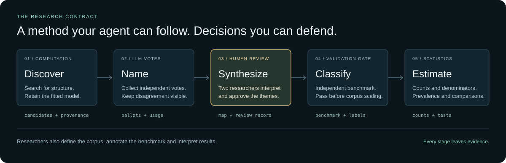

<p align="center"><a href="https://topicllm.dev"></a></p>

# TopicLLM

### From language to evidence. Every step open.

**A research workflow for agents to execute and humans to understand, review and use.**

[Explore the live demonstration](https://topicllm.dev/app/) · [Read the methods](https://topicllm.dev/paper/) · [Run with your agent](REPRODUCE.md) · [Original Study 1 data](docs/data/README.md)



What is a large collection of posts talking about? How does that conversation change? TopicLLM finds groups of similar language, asks an LLM to propose names, and helps researchers turn those groups into meaningful themes. After independent validation, a classifier can label the corpus and estimate theme prevalence across time.

The agent handles computation, files and the evidence trail. Researchers decide what the themes mean, review validation and interpret the findings.

## The actual study, ready to explore

The default demonstration uses **original Study 1 alcohol-brand data**, released by the author: **5,872 records from 11 brands**, with a separate **704-text lockdown discovery input**. Study 2 user data are not included. Collector and administrative fields have been removed.

This is an **illustrative modern rerun**, not a promise of identical historical outputs. Topic models and LLMs include probabilistic steps. A fresh run can group or label some posts differently, especially when the random seed, model, or software version changes.

The site lets you walk through the method, search 5,871 nonempty original posts, collect independent OpenAI naming votes and inspect live classifications. Published dissertation results are clearly identified beside new demonstration outputs.

## Start in minutes

Fork and clone this repository, then create and activate a Python 3.11+ environment:

```sh
python -m venv .venv
# PowerShell: .venv\Scripts\Activate.ps1
# bash/zsh: source .venv/bin/activate
python -m pip install ".[dev]"
topicllm --profile quickcheck --output-dir runs/check
```

The free quickcheck verifies hashes, reconstructs the original cohort and confirms 5,872 records, 11 brands, one blank text, 5,871 nonempty analysis records and 704 discovery texts. It makes no model calls.

To rerun discovery:

```sh
python -m pip install ".[ml,dev]"
topicllm --profile study1-demo --output-dir runs/study1 --plan
topicllm --profile study1-demo --output-dir runs/study1
```

The first run may download the embedding model and NLP resources. Discovery is local and makes no paid OpenAI calls. An [installable wheel and source archive](https://topicllm.dev/reproduce/) are also available; this is not a claim of a PyPI release.

## Give your agent a method

> Read AGENTS.md, REPRODUCE.md and docs/protocol.json. Verify the original Study 1 inputs. Run discovery in a new output directory. Explain the resulting topics and outliers, retain the evidence, and prepare the next steps and their costs for my review. Do not invent human labels, approvals or historical outputs.

| Stage | Agent executes | Researcher reviews |
| --- | --- | --- |
| Discover | Embeddings, UMAP, HDBSCAN and coherence search | Sampling, topic structure and coverage |
| Name | Independent LLM calls and vote tallies | Whether labels describe the underlying posts |
| Synthesize | Evidence packet and proposed theme map | Two researchers approve interpretation |
| Classify | Benchmark comparison, then corpus labeling | Independent annotations and per-theme performance |
| Estimate | Counts, prevalence and proportional tests | Denominators, assumptions and scientific meaning |

[REPRODUCE.md](REPRODUCE.md) provides exact commands and handoffs. [AGENTS.md](AGENTS.md) defines the execution contract. [protocol.json](docs/protocol.json) connects the method to machine-readable settings.

## Evidence you can inspect

The recorded modern discovery retained **1,200 candidate results**. It selected **five statistical topics** with c_v **0.7803**, leaving **433 of 704 texts as outliers**. That coverage limitation is visible; these topics are not automatically the dissertation's five interpreted themes. The [recorded run](https://topicllm.dev/validation/) includes settings, assignments, counts and environment. Different seeds at the reported parameter settings returned 9, 10 and 9 topics; repeating the same seed reproduced assignments in the recorded environment.

The dissertation remains the source for its reported seven topics, five themes and prevalence findings. Original papers and supplements remain byte-identical under [source-integrity.json](source-integrity.json). [Data provenance](docs/data/README.md) documents preparation and minor printed brand/count pairing differences without altering the source.

Research classification requires an independent human benchmark; the release does not invent one. The five-stage package does not implement LIWC sentiment analysis or Study 2's exposure-index/GSEM analysis. Legacy synthetic fixtures remain engineering tests, not the main demonstration.

## Repository map

| Path | Purpose |
| --- | --- |
| `dtm_pipeline/` | Installable Python workflow |
| `docs/data/study1/` | Original Study 1 release and recorded discovery |
| `docs/` | Website, methods and research guide |
| `worker/` | Server-side OpenAI gateway and atomic usage accounting |
| `examples/` | Research configuration examples |
| `tests/`, `dtm_pipeline/tests/` | Software and data-integrity checks |
| `scripts/` | Build, source verification and release tooling |

The public service supports 200 calls per browser session and 600 per shared network per UTC day, within a shared **$20/day** and **$620/month** allowance. Researchers use their own approved credentials and explicit budgets for full workflows. Keys never belong in prompts or version control.

Code: MIT. Documentation and original author-created materials: see [LICENSE-CONTENT.md](LICENSE-CONTENT.md). Third-party brand text is not relicensed by those licenses. Cite the dissertation, methods and software using [CITATION.cff](CITATION.cff).
