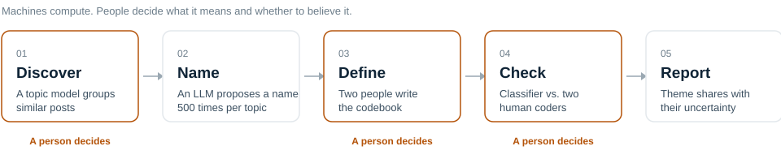

<p align="center"></p>
<h1 align="center">TopicLLM</h1>
<p align="center"><b>From a collection of texts to themes you can explain and measure.</b><br>Open-source Python software. Human interpretation. An executable protocol for coding agents.</p>
<p align="center"><a href="https://topicllm.dev/tutorial/">Explore the tutorial</a> · <a href="https://topicllm.dev/paper/">Read the software paper</a> · <a href="https://topicllm.dev/use/">Use your own data</a> · <a href="https://github.com/jethomasphd/TopicLLM/releases">Download a release</a></p>

TopicLLM helps researchers answer two connected questions: **What is this collection of texts about? How often do those themes appear?** It combines transformer-based topic modeling, repeated large language model (LLM) naming, human-defined coding rules and a check against independent human coding in one documented workflow.

Bring a research question and a CSV of short texts, such as social media posts or open-ended survey responses. The software produces candidate topics, proposed names, review materials, classification checks and theme-share tables. **You define the themes and decide whether the measurements are trustworthy.** A coding agent can run the maintained Python scripts and organize the evidence; you can also run the commands yourself.

> **Status: pilot software.** Developed through Jacob E. Thomas's dissertation research at The University of Texas at Austin; not independently validated. The included example is a methodological teaching walkthrough. [Feedback and replication reports are welcome.](https://github.com/jethomasphd/TopicLLM/issues)

## Start here

| If you want to… | Start with… |
|---|---|
| Understand the idea and try it without installing anything | The [interactive tutorial](https://topicllm.dev/tutorial/): follow an example, name a topic and code five posts |
| Understand the methodology and its implementation | The [software paper](https://topicllm.dev/paper/), the current methods reference |
| Run an analysis on your own texts | The [setup guide](https://topicllm.dev/use/), then [REPRODUCE.md](REPRODUCE.md) for stage-by-stage commands |
| Ask a coding agent to help | Fork this repository and give the agent [AGENTS.md](AGENTS.md) and [REPRODUCE.md](REPRODUCE.md) |
| Read the research that informed the software | The unchanged dissertation and two studies in the [research library](https://topicllm.dev/research/) |

## What you are looking at

This repository contains the **Python software**, a **worked example with public evidence**, and the **website and software paper** that explain how to use it. The original dissertation and two research studies are preserved separately as the project's research foundation.

The example asks whether themes found in Donald Trump's **first presidential campaign** also appear during his **first term**. It discovers topics in campaign posts from June 16, 2015 to Election Day 2016, then applies human-defined themes to posts from January 20, 2017 through the archive's end on January 8, 2021. It shows the method on a familiar public corpus; it does not reproduce the dissertation's findings.

A **topic** groups texts with similar language. A **theme** is a meaning researchers define after reading those texts. A **codebook** records definitions, inclusion and exclusion rules, and examples. Several topics can become one theme. The classifier applies that codebook, and its assignments are checked against human coding before they can support research claims.



## Try the free, offline check

Clone the repository below, or clone your own fork. Use Python 3.11 or newer.

```bash
git clone https://github.com/jethomasphd/TopicLLM
cd TopicLLM
python -m venv .venv
# Activate on macOS/Linux: source .venv/bin/activate
# Activate in Windows PowerShell: .venv\Scripts\Activate.ps1
python -m pip install ".[dev]"
topicllm --profile quickcheck --output-dir runs/quickcheck
```

This checks the bundled 34,416-post archive and its recorded hashes. It makes no API calls and does not rerun the model or validate the science. To install without a checkout, download the wheel from a [tagged release](https://github.com/jethomasphd/TopicLLM/releases); see the [package guide](dtm_pipeline/README.md).

Topic discovery needs the ML extra (`python -m pip install ".[ml]"`) and runs locally without API charges. Naming and classification call OpenAI and require an explicit `--budget-usd`. For your own data, start from [`examples/your-data-config.json`](examples/your-data-config.json) and run `topicllm --profile research --config my-config.json --stages all --plan` to see counts and a rough cost before execution.

## Work with a coding agent

Open your fork in a coding-agent environment and give it this starting instruction, replacing the file path and column name:

```text
Read AGENTS.md and REPRODUCE.md. Run the free quickcheck.
Use my CSV at PATH/TO/FILE.csv; the text column is TEXT_COLUMN.
Help me specify the research question and analysis settings, then show me
the execution plan and cost before making any paid calls.
Run the maintained Python scripts and keep every output. Do not invent results.
Stop for human review of the topics, codebook, independent coding and classifier.
```

The agent executes the workflow; researchers supply the interpretation, independent coding and acceptance decisions. Your own corpus runs in your environment. The public website provides a bounded learning experience using the Trump example.

## The five steps

| Step | What happens | Who decides |
|---|---|---|
| **Discover** | BERTopic groups similar texts; the tutorial searches 1,200 settings and applies a declared selection rule | A person reads the posts and adopts a solution |
| **Name** | An LLM names each topic hundreds of times; the most common name is a proposal | — |
| **Define** | Researchers can combine topics into themes and write a codebook: definitions, inclusions, exclusions and a rule for texts that fit several themes | **People** |
| **Check** | A classifier, chosen on a practice sample, is tested against two independent human coders on a held-out random sample (target: >85% agreement, every theme found) | **People** accept or reject it |
| **Report** | Theme shares across the target corpus, every theme and the residual, one shared denominator | — |

Four human decisions are required: adopting topics, approving the codebook, completing independent human coding with adjudication, and accepting the classifier after reviewing its errors. The [protocol](docs/protocol.json) records the stages and gates in machine-readable form.

## What the example shows

Two independent human coding passes, followed by adjudication, classified a random sample of 250 first-term posts. **84% fit a campaign theme** (95% CI 79–88%). The human passes agreed on 68% before adjudication; the frozen LLM classifier matched the resulting consensus on 70%, below its declared agreement requirement. Its full-corpus assignments are retained as an unvalidated teaching demonstration. The [tutorial](https://topicllm.dev/tutorial/#check) shows the check; the [paper's limitations](https://topicllm.dev/paper/#limits) explain what must change before using such measurements for research.

<details>
<summary><b>Recorded example: API calls and cost</b></summary>

| Step | Calls | Cost |
|---|---:|---:|
| Naming: 500 votes × 12 topics, plus two discarded attempts | 9,808 | $3.80 |
| Choosing the classifier (100 practice posts) | 100 | $0.41 |
| The held-out check (250 posts) | 250 | $1.02 |
| Classifying all 26,239 first-term posts | 26,263 | $107.24 |
| **Total** (GPT-4o, recorded list prices) | **36,421** | **$112.47** |

These are the completed example's costs, not a quote for another corpus. Start with `--plan` and set your own budget.

</details>

## Check every number yourself

No private data or API calls needed:

```bash
python scripts/check-published-metrics.py          # agreement, κ, intervals, per-theme metrics
python scripts/estimate-human-sample-prevalence.py # the 84% and every theme share
python scripts/apply-selection-rule.py             # the topic-selection rule on all saved candidates
```

The recorded evidence lives in [`docs/data/trump/campaign/`](docs/data/trump/campaign/). Individual human labels, adjudication notes and post-level predictions are kept private; the published aggregate counts reproduce every metric.

## Repository map

| Path | What it is |
|---|---|
| `dtm_pipeline/` | The Python package (`topicllm` command): stages, provenance, local review and coding interfaces |
| `examples/` | Tutorial and your-data configurations, plus a tiny synthetic CSV |
| `docs/` | The website, the paper, figures, data cards and the tutorial's public evidence |
| `scripts/` | Builders (figures, tutorial, shell, PDF, guide index) and checkers |
| `worker/` | The Cloudflare Worker: live lab, Ask guide, quotas |
| Root `S1–S3`, `THOMAS-PRIMARY-2025.pdf` | The original dissertation and its supplements, protected byte for byte |

## Software paper and original research

The current methods reference is [*TopicLLM: software for turning short texts into human-defined, checked themes*](https://topicllm.dev/paper/) by Jacob E. Thomas. It explains the workflow, links it to the implementation and presents the Trump example. It replaces the earlier methods draft as the guide to this software.

The dissertation and two original studies stand on their own, unchanged, in the [research library](https://topicllm.dev/research/). They were reviewed by a dissertation committee, which is not journal peer review. The software develops a reusable topic-to-theme workflow; it does not implement every analysis in those studies.

## License and citation

Code: MIT. Documentation: CC BY 4.0. Trump posts: "Data files © Original Authors" per the [Kaggle source](https://www.kaggle.com/datasets/codebreaker619/donald-trump-tweets-dataset); not relicensed here. See [LICENSE-CONTENT.md](LICENSE-CONTENT.md) and [CITATION.cff](CITATION.cff). Questions and replication reports: [issues](https://github.com/jethomasphd/TopicLLM/issues).
