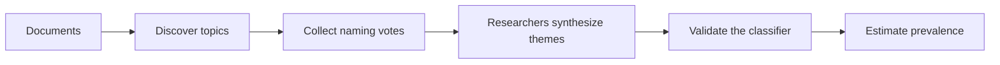

<p align="center"></p>
<h1 align="center">TopicLLM</h1>
<p align="center"><strong>From language to evidence. Every step open.</strong><br>A human-guided research method. An executable protocol for your agent.</p>
<p align="center"><a href="https://topicllm.dev/app/">Explore the Trump walkthrough</a> · <a href="https://topicllm.dev/paper/">Read the methods</a> · <a href="https://topicllm.dev/audit/">Research in action</a></p>


**What is a large collection of text about—and how does that change?** TopicLLM connects topic discovery, repeated LLM naming, human interpretation, classifier validation and prevalence estimation. It gives researchers a method to inspect and coding agents a concrete implementation to execute.

Born in dissertation research at **The University of Texas at Austin**, this release has two clear entry points:

- **Research in action:** the unchanged dissertation and two study papers document applications to alcohol marketing and information dynamics during COVID-19. They are historical research examples, available for review. Dissertation datasets are not distributed.
- **Learn by doing:** one new public corpus—**34,416 Trump account posts, June 16, 2015–January 8, 2021**—walks you through the method. This transfers the methodology to another domain; it does not reproduce the dissertation findings.

The selected Kaggle archive ends January 8, before the first term ended. It includes retweets and posts recorded as deleted. Account posts are not all personally authored statements, and the archive is not a guarantee of complete coverage. [Data card and attribution](docs/data/README.md).

## Explore → fork → run → review



A **topic** groups similar language. A **theme** is a researcher-defined interpretation. A **label** assigns a document to a theme. Keeping these distinct prevents an attractive model output from becoming an unsupported scientific claim.

The [visual walkthrough](https://topicllm.dev/app/) lets you inspect recorded discovery, try live OpenAI calls and draft a theme map. Its draft labels are teaching aids. Research requires actual researcher review and an independent benchmark before corpus classification. The website guide explains the program; your fork runs the analysis.

## Start locally

Python 3.11+; use an isolated environment. In your fork:

```bash
python -m venv .venv
# Activate: Windows PowerShell .venv/Scripts/Activate.ps1
# macOS/Linux: source .venv/bin/activate
python -m pip install ".[dev]"
topicllm --profile quickcheck --output-dir runs/quickcheck
```

The free quickcheck verifies the exact corpus bytes, IDs, date window and counts. It is an installation and data-integrity check, not model validation.

```bash
python -m pip install ".[ml]"
topicllm --profile trump-demo --plan
topicllm --profile trump-demo --output-dir runs/trump
```

Discovery runs on the full eligible corpus with 50 parameter draws and 24 topic ceilings per draw. It uses local compute, downloads the embedding model and NLTK resources when needed, and makes no paid API calls. Runtime depends on hardware. Do not expect seven topics: topic count is an observed result.

**Giving this to an agent?** Start with this instruction:

> Read AGENTS.md, REPRODUCE.md, docs/protocol.json and the maintained methods. Verify the tutorial corpus, explain the analysis plan and costs, then run the maintained scripts. Preserve the evidence. Stop for my scientific decisions; do not invent human review, benchmark annotations or findings.

[Complete execution recipe](REPRODUCE.md) · [Agent contract](AGENTS.md) · [Download package](https://topicllm.dev/reproduce/)

## What the software retains

| Stage | Mechanism | Reviewable evidence |
|---|---|---|
| Discover | MiniLM → UMAP → HDBSCAN → c-TF-IDF; select by cᵥ coherence | Every candidate, exclusions, outliers, assignments, fitted model |
| Name | Independent LLM calls; modal candidate name | Raw ballots, tally, prompts, model and usage |
| Synthesize | Two researchers interpret and agree | Worksheet, theme map, evidence-bound attestation |
| Classify | Independent benchmark before scaling | Per-theme metrics, confusion counts, labels and errors |
| Estimate | Declared periods and denominators | Counts, prevalence, two-proportion tests and multiplicity |

No research taxonomy or human benchmark is pre-approved for the Trump corpus. The package stops at the corresponding gates. Paid steps require an explicit `--budget-usd` and private credentials. The public Worker accepts only tutorial examples; use your own approved environment for research data.

## Research in action

[Dissertation](THOMAS-PRIMARY-2025.pdf) · [Study 1: alcohol marketing](https://topicllm.dev/studies/1/) · [Study 2: information dynamics](https://topicllm.dev/studies/2/)

The papers preserve the research record byte for byte. The maintained [methods preprint](https://topicllm.dev/paper/) explains the complete method and its transfer to the Trump archive. The studies received dissertation committee review, distinct from journal peer review. Independent replication of TopicLLM remains open work. Software tests and a successful tutorial run do not establish scientific validity in a new domain.

Topic models and LLMs include probabilistic steps. Seeds, model revisions, dependencies and hardware can change groupings or names. Reproducibility means retaining enough information to rerun and assess the process—not promising identical output across changing environments.

## Contribute and cite

Questions, replication reports and improvements are welcome through [GitHub issues](https://github.com/jethomasphd/TopicLLM/issues). See [CITATION.cff](CITATION.cff), [source integrity](source-integrity.json), [deployment](DEPLOYMENT.md) and [data handling](https://topicllm.dev/privacy/).

Code: MIT. Documentation: CC BY 4.0 unless otherwise stated. Trump text: **Data files © Original Authors**, as designated by the selected Kaggle source; it is not relicensed by this project. [Material-specific terms](LICENSE-CONTENT.md).
