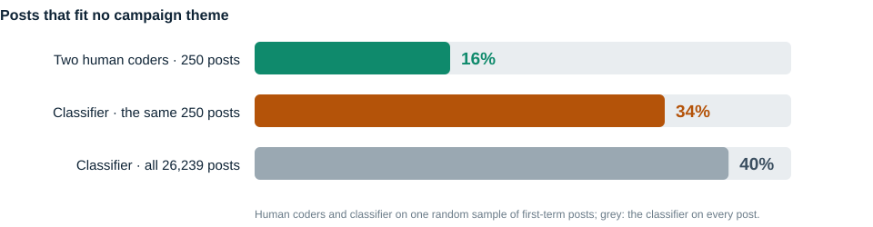

<p align="center"></p>
<h1 align="center">TopicLLM</h1>
<p align="center"><b>Turn a pile of text into themes you can measure.</b><br>A topic model finds the clusters. An LLM proposes names. People decide what they mean.<br>Then the machine is checked against the people before any number is believed.</p>
<p align="center"><a href="https://topicllm.dev/tutorial/">Tutorial</a> · <a href="https://topicllm.dev/use/">Use it</a> · <a href="https://topicllm.dev/research/">Research</a> · <a href="https://topicllm.dev/paper/">Paper</a></p>

> **Status: pilot software** from Jacob E. Thomas's dissertation research at The University of Texas at Austin. It has not been independently validated. [Try to break it.](https://github.com/jethomasphd/TopicLLM/issues)



In the [tutorial](https://topicllm.dev/tutorial/), themes found in Donald Trump's campaign posts are looked for in his first-term posts. Two people coded a random sample of 250 posts: **84% fit a campaign theme** (95% CI 79–88%), and a third criticized political opponents. The LLM classifier matched them only 70% of the time, short of its 85% target, and on those same posts it sent about twice as many to "fits no theme" (34% against 16%). The method caught it, and it hinted why: the two coders agreed with each other only 68% of the time, which suggests the codebook itself needs work. That check is the point.

## Run it

```bash
git clone https://github.com/jethomasphd/TopicLLM && cd TopicLLM
python -m venv .venv && source .venv/bin/activate      # Windows: .venv\Scripts\Activate.ps1
python -m pip install ".[dev]"
topicllm --profile quickcheck --output-dir runs/quickcheck   # free, offline, seconds
```

Topic discovery needs the ML extra (`python -m pip install ".[ml]"`) and runs locally for free. Naming and classification call OpenAI and refuse to run without an explicit `--budget-usd`. For your own data, start from [`examples/your-data-config.json`](examples/your-data-config.json) and run `topicllm --profile research --config my-config.json --stages all --plan` to see counts and a rough cost before anything runs.

**Agents:** read [AGENTS.md](AGENTS.md), then [REPRODUCE.md](REPRODUCE.md). Run the scripts, keep every output, and stop at the four human decisions.

---

## The five steps

| Step | What happens | Who decides |
|---|---|---|
| **Discover** | BERTopic searches 1,200 settings; the highest-coherence solution in which no topic holds a majority of documents is selected | The rule, then a person who reads the posts |
| **Name** | An LLM names each topic hundreds of times; the most common name is a proposal | — |
| **Define** | Two researchers turn topics into a codebook: definitions, inclusions, exclusions, a rule for posts that fit several themes | **People** |
| **Check** | A classifier, chosen on a practice sample, is tested against two independent human coders on a held-out random sample (target: >85% agreement, every theme found) | **People** accept or reject it |
| **Report** | Theme shares across the target corpus, every theme and the residual, one shared denominator | — |

A *topic* groups similar language. A *theme* is a meaning people define. A *classification* assigns a document to a theme. Keeping them apart stops an attractive model output from becoming an unsupported claim.

## What the tutorial cost

| Step | Calls | Cost |
|---|---:|---:|
| Naming: 500 votes × 12 topics, plus two discarded attempts | 9,808 | $3.80 |
| Choosing the classifier (100 practice posts) | 100 | $0.41 |
| The held-out check (250 posts) | 250 | $1.02 |
| Classifying all 26,239 first-term posts | 26,263 | $107.24 |
| **Total** (GPT-4o, recorded list prices) | **36,421** | **$112.47** |

## Check every number yourself

No private data or API calls needed:

```bash
python scripts/check-published-metrics.py          # agreement, κ, intervals, per-theme metrics
python scripts/estimate-human-sample-prevalence.py # the 84% and every theme share
python scripts/apply-selection-rule.py             # the topic-selection rule on all saved candidates
```

The recorded evidence lives in [`docs/data/trump/campaign/`](docs/data/trump/campaign/). Individual human labels, adjudication notes and post-level predictions are kept private; the published aggregate counts reproduce every metric.

## Repository map

| Path | What it is |
|---|---|
| `dtm_pipeline/` | The Python package (`topicllm` command): stages, provenance, local review and coding interfaces |
| `examples/` | Tutorial and your-data configurations, plus a tiny synthetic CSV |
| `docs/` | The website, the paper, figures, data cards and the tutorial's public evidence |
| `scripts/` | Builders (figures, tutorial, shell, PDF, guide index) and checkers |
| `worker/` | The Cloudflare Worker: live lab, Ask guide, quotas |
| Root `S1–S3`, `THOMAS-PRIMARY-2025.pdf` | The original dissertation and its supplements, protected byte for byte |

## The research

The dissertation and the papers drawn from it stand on their own, unchanged, in the [research library](https://topicllm.dev/research/). The tutorial is a walkthrough of the method on new data, not a reproduction of the dissertation's findings. The studies were reviewed by a dissertation committee, which is not journal peer review.

## License and citation

Code: MIT. Documentation: CC BY 4.0. Trump posts: "Data files © Original Authors" per the [Kaggle source](https://www.kaggle.com/datasets/codebreaker619/donald-trump-tweets-dataset); not relicensed here. See [LICENSE-CONTENT.md](LICENSE-CONTENT.md) and [CITATION.cff](CITATION.cff). Questions and replication reports: [issues](https://github.com/jethomasphd/TopicLLM/issues).
